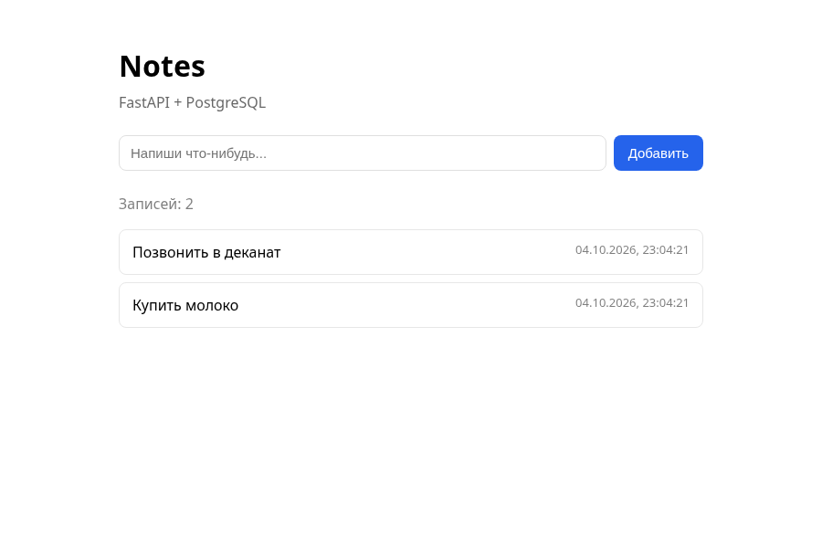

# Заметки

Простое трёхуровневое приложение: форма сохраняет заметку в PostgreSQL, список подгружает оттуда же

## Стек

Python, FastAPI, SQLAlchemy + asyncpg, PostgreSQL, uvicorn

## Как устроено

Фронт - один статический html, он ходит в бэкенд на `/api/items`. Бэкенд пишет и читает заметки, таблицу создаёт сам при старте. База поднимается отдельно и слушает 5432

```
backend/
  app/main.py       #приложение и эндпоинты
  app/database.py   #движок, сессии, ожидание готовности бд
  app/models.py     #таблица notes
  app/schemas.py    #схемы запроса и ответа
  requirements.txt
  .env.example
frontend/
  index.html        #форма и список
docs/
  screenshot.png
```

Эндпоинтов три: `GET /api/health` - проверка живости, `GET /api/items` - список, `POST /api/items` - сохранить. Фронт в этой лабе открывается как обычный файл, поэтому в бэкенде включён cors

## Данные

Одна таблица в PostgreSQL:

- `notes` - заметка: текст и когда создана

Всё хранится в базе, поэтому записи остаются и после перезагрузки страницы, и после перезапуска бэкенда

## Запуск

Нужен Python 3.11+ и PostgreSQL. Если postgresql уже стоит системно, то `sudo systemctl start postgresql`. Без рута поднимаем свой экземпляр прямо в проекте:

```
initdb -D .pgdata -U postgres --auth=trust
pg_ctl -D .pgdata -o "-p 5432 -k $PWD/.pgdata -c listen_addresses='127.0.0.1'" -l .pgdata/log start
psql -h 127.0.0.1 -p 5432 -U postgres -c "CREATE ROLE app LOGIN PASSWORD 'app';" -c "CREATE DATABASE appdb OWNER app;"
```

Данные базы лежат в `.pgdata`, он в `.gitignore`. Остановить - `pg_ctl -D .pgdata stop`

Дальше бэкенд:

```
cd backend
cp .env.example .env   # вписать доступы к бд
python3 -m venv .venv
source .venv/bin/activate
pip install -r requirements.txt
uvicorn app.main:app --reload
```

`DATABASE_URL` в `.env`, сам `.env` в `.gitignore`, в репозитории только пример

## Как проверить

Открыть `frontend/index.html` в браузере, вписать что-нибудь в форму и нажать добавь. Запись появится в списке, после перезагрузки страницы (F5) она останется на месте - она реально легла в базу

Быстрее видно ответы в терминале:

```
curl http://localhost:5000/api/health
curl -X POST http://localhost:5000/api/items -H 'Content-Type: application/json' -d '{"text":"проверка"}'
curl http://localhost:5000/api/items
```

Ещё есть `http://localhost:5000/docs` - схема api с кнопками, эндпоинты можно потыкать прямо в браузере



## Ограничения

- Заметки только создаются и читаются, удаления и редактирования нет
- Таблица создаётся при старте бэкенда, миграций нет. Когда схема начнёт меняться, понадобится alembic
- Авторизации нет, писать может кто угодно кто достучится
- Локальный запуск без докера. Впереди nginx, контейнеры и ci
